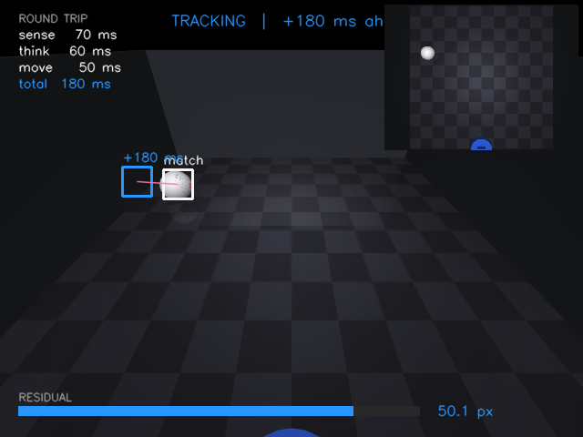
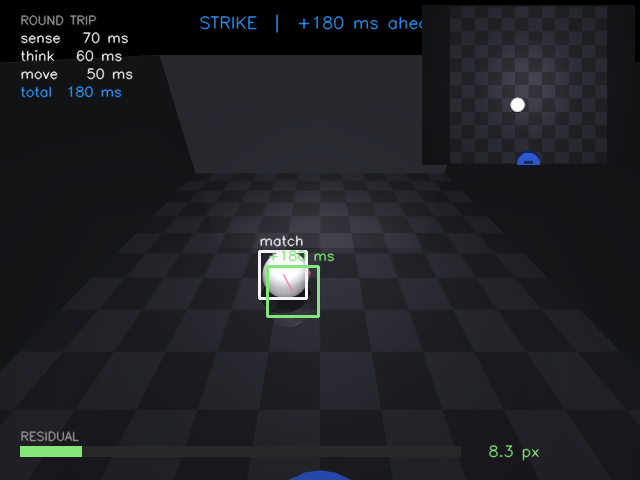

# Forward Model Ball Tracking

A stationary robot watches a ball roam a 3D arena and runs a **forward model**:
it predicts where the ball will be after the unavoidable sense -> think -> move
latency (180 ms), compares each prediction against reality, and corrects. Once
its predictions are consistently accurate it **strikes** the ball and relocates,
then begins tracking afresh from its new post.

> Built on **MuJoCo** (real 3D physics + offscreen rendering, installs cleanly on
> Windows with no compiler) and **OpenCV** for the HUD. The Kalman forward model
> is written from scratch.




## The core idea: predict -> act -> correct

Sensing, thinking, and acting all take time. If the robot aims at where it last
*saw* the ball, it always acts on stale information and misses. The forward model
extrapolates the ball's state forward by the full pipeline latency so the robot
acts on where the ball *will be*.

```
sense (70 ms) + think (60 ms) + move (50 ms) = 180 ms horizon
```

| Stage | What happens |
|-------|--------------|
| Sense | a camera frame arrives, already 70 ms old |
| Detect | the ball is located in the image |
| Back-project | the pixel is mapped onto the floor plane -> world (x, y) |
| Predict | a Kalman filter extrapolates 180 ms ahead |
| Correct | when reality arrives, the residual (px error) updates the filter |
| Act | once the residual stays small, the robot strikes and relocates |

The on-screen **residual bar** is the heart of the demo: it starts large (the
prediction overshoots) and shrinks as the velocity estimate locks on.

## Why world-space state estimation

Detections happen in image pixels, but pixel motion is wildly non-linear under
perspective (a ball near the camera moves hundreds of px; the same ball far away
barely moves). So the filter estimates state in **world coordinates** on the
ground plane, where constant-velocity motion is an accurate model, then projects
predictions back into the image for display. This is the standard monocular
ground-plane assumption and is what makes the residual actually converge.

## Architecture

```
main.py            # loop: step sim -> render -> track -> draw -> (strike/relocate)
controller.py      # the predict/act/correct controller
config.yaml        # all tunable parameters

sim/
  arena.py         # builds the MuJoCo model (empty box; pillars wired for Phase 2)
  ball.py          # smooth random motion, wall bounce, robot keep-out zone
  robot.py         # stationary base, faces the arena, relocates after a hit
  camera.py        # render + project (3D->2D) + unproject (pixel->ground plane)
  world.py         # owns MjModel/MjData, syncs mocap bodies each frame

perception/
  base.py          # Detector interface (Phase 2 YOLO drops in here)
  sim_detector.py  # Phase 1: ground-truth projection + pixel noise

forward_model/
  kalman.py        # constant-velocity Kalman filter (world meters), from scratch
  latency.py       # sense delay line + prediction/residual scheduling
  residual.py      # smoothed residual + confidence gating

viz/
  overlay.py       # match box, +180 ms box, overshoot vector, residual bar, HUD
```

## Setup

Requires Python 3.12 (MuJoCo ships prebuilt wheels for it; 3.14 has none yet).

```bash
py -3.12 -m venv .venv
.venv\Scripts\python.exe -m pip install -r requirements.txt
```

## Run

```bash
# live window (press q or ESC to quit)
.venv\Scripts\python.exe main.py

# overhead debug inset (shows the true ball + robot positions)
.venv\Scripts\python.exe main.py --top

# headless: render N frames, save preview PNGs + residual stats
.venv\Scripts\python.exe main.py --headless 1500 --top
```

Tune behaviour in `config.yaml` (latency, ball speed/turn rate, Kalman noise,
strike threshold). No code changes needed.

## Status

**Phase 1 complete:** empty arena, smooth random ball, stationary robot with a
single camera, simulated detector, world-space Kalman forward model, latency
pipeline, residual-driven confidence, strike + relocate, and the full HUD.

**Phase 2 (next):** add pillars (`sim/arena.py` already accepts them) and swap
`perception/sim_detector.py` for a real YOLO detector behind the same interface.
